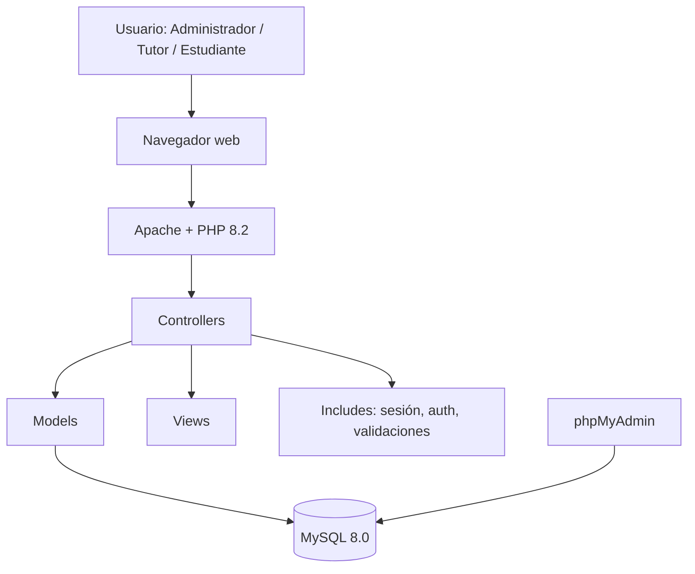

# Diagrama de arquitectura

## Explicación

1. El usuario interactúa con el sistema desde el navegador.
2. Apache sirve la aplicación PHP.
3. Los controladores reciben las acciones y aplican las reglas del flujo.
4. Los modelos ejecutan las operaciones sobre MySQL mediante PDO.
5. Las vistas muestran la información al usuario.
6. Los módulos de `includes/` centralizan autenticación, sesiones,
   validaciones y funciones reutilizables.
7. phpMyAdmin permite revisar la base de datos durante desarrollo.
